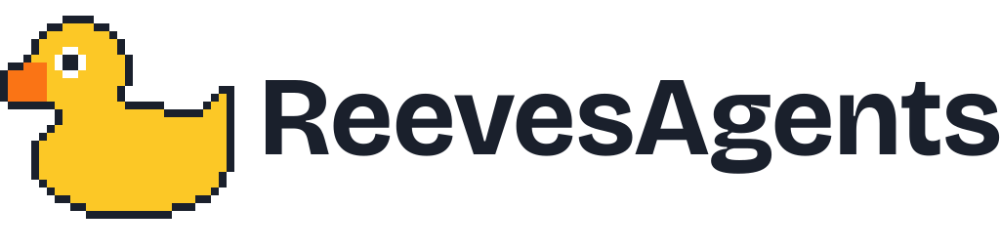
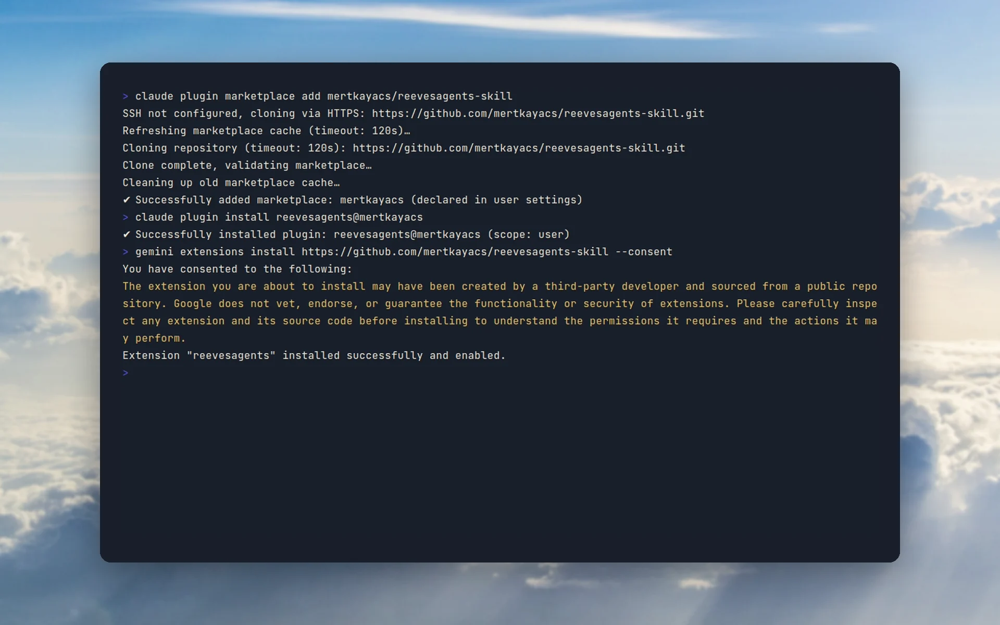

<p align="center">
  <picture>
    <source media="(prefers-color-scheme: dark)" srcset="docs/brand/svg/reevesagents-logo-on-dark.svg">
    
  </picture>
</p>

<h1 align="center">Teach one agent. Run the whole team.</h1>

<p align="center">
  The skill and plugin manifests that let an AI coding CLI drive reevesagents.<br>
  <b>Claude Code, Codex, Kimi Code and Gemini CLI. One SKILL.md and a manifest for each.</b>
</p>

<p align="center">
  
  <a href="LICENSE"></a>
  
  <a href="https://hol.org/registry/plugins/mertkayacs%2Freevesagents-skill"></a>
  <a href="https://github.com/mertkayacs/reevesagents-skill"></a>
</p>

<p align="center">
  <a href="#quick-start"></a>
  <a href="https://github.com/mertkayacs/reevesagents"></a>
  <a href="https://reevesagents.mertkayacs.com/docs/?utm_source=github&utm_medium=readme&utm_campaign=reevesagents-skill-repo&utm_content=docs-badge"></a>
</p>

<p align="center">
  <picture>
    <source media="(prefers-color-scheme: dark)" srcset="docs/assets/readme/hero-dark.webp">
    
  </picture>
</p>

reevesagents-skill teaches an AI coding CLI to start, read and steer other coding CLIs through [reevesagents](https://github.com/mertkayacs/reevesagents). It ships one `SKILL.md`, plugin manifests for Claude Code, Codex, Kimi Code and Gemini CLI, and an `install.sh` for skill folders. Every plugin starts a single program, `reevesagents mcp`, from your own PATH.

---

## Why reevesagents-skill

The skill gives your host CLI the steps to run a team. reevesagents runs the terminals.

|  |  |
|---|---|
|  **One skill, four hosts** | The same [SKILL.md](skills/reevesagents/SKILL.md) ships as a Claude Code plugin, a Codex plugin, a Kimi Code plugin and a Gemini CLI extension. |
|  **Plain files you can read** | The repository holds a Markdown skill, JSON manifests, icons and a short shell script. Every plugin starts `reevesagents mcp` and nothing else. |
|  **Asks before it skips** | The skill tells the host to keep worker permission prompts on unless you asked otherwise, and to treat worker output as data. |
|  **Your machine, your logins** | reevesagents runs every agent as the real CLI in a tmux window, with that CLI's own login. Its Web UI listens on 127.0.0.1 only. |

## Features

**Contents**

- [SKILL.md](skills/reevesagents/SKILL.md): the drive loop (list providers, spawn, read, send text then press enter, kill or stop), a worked example and how to spawn a team.
- [install.sh](install.sh) copies the skill to `~/.claude/skills/reevesagents` and `~/.agents/skills/reevesagents`, and `./install.sh uninstall` removes both.
- Manifests for Claude Code ([.claude-plugin](.claude-plugin/plugin.json)), Codex ([.codex-plugin](.codex-plugin/plugin.json)), Kimi Code ([kimi.plugin.json](kimi.plugin.json)) and Gemini CLI ([gemini-extension.json](gemini-extension.json)), plus [.mcp.json](.mcp.json).

**What runs on your machine**

- Each plugin starts `reevesagents mcp` from your PATH and talks to the host over stdio. When the model asks for an agent, reevesagents starts tmux and the CLI you named.
- `permissions:"skip"` starts a worker with that CLI's own bypass flag, such as `--dangerously-skip-permissions` for Claude Code or `--yolo` for Kimi. It is opt-in for each spawn, and the default stays `ask` unless you change `default_permissions`.

## Quick start

Install reevesagents and check the machine:

```sh
npm install -g reevesagents
reevesagents doctor
```

Claude Code:

```sh
claude plugin marketplace add mertkayacs/reevesagents-skill
claude plugin install reevesagents@mertkayacs
```

Codex:

```sh
codex plugin marketplace add mertkayacs/reevesagents-skill
codex plugin add reevesagents@mertkayacs
```

Gemini CLI:

```sh
gemini extensions install https://github.com/mertkayacs/reevesagents-skill
```

Any CLI that reads ~/.claude/skills or ~/.agents/skills, without a plugin. Then connect the MCP to the host that should lead, here Claude Code:

```sh
git clone https://github.com/mertkayacs/reevesagents-skill
cd reevesagents-skill && ./install.sh
reevesagents attach cc
reevesagents hosts
```

Restart the host CLI afterwards so it loads the skill and the MCP tools.

### Requirements

- reevesagents on your PATH, which needs Node.js 22.12 or newer, and tmux 3.0 or newer on macOS, Linux and WSL.
- At least one installed, signed-in coding CLI for the workers.
- A local shell. claude.ai chat and Cowork cannot start a program on your machine, so the plugin does nothing there.

## FAQ

<details>
<summary><b>Do I need reevesagents installed?</b></summary>

Yes. The plugin starts the `reevesagents` binary from your PATH. Install it with `npm install -g reevesagents` first.
</details>

<details>
<summary><b>What does the plugin run on my machine?</b></summary>

One program, `reevesagents mcp`, over stdio. The CLIs it starts use your existing logins and talk to their own model providers, the same as when you run them by hand.
</details>

<details>
<summary><b>Where do I report a security problem?</b></summary>

Privately, through a security advisory on the main repository. [SECURITY.md](SECURITY.md) has the link and what to include.
</details>

If reevesagents-skill is useful to you, a ⭐ helps other people find it.

## License

[Apache-2.0](LICENSE). reevesagents-skill is built by Mert Kaya at Eschatia Labs, an independent, non-profit open-source AI research lab. Photos behind the screenshots are credited in [docs/assets/readme/CREDITS.md](docs/assets/readme/CREDITS.md).

[](https://reevesagents.mertkayacs.com/?utm_source=github&utm_medium=readme&utm_campaign=reevesagents-skill-repo&utm_content=views-badge)
